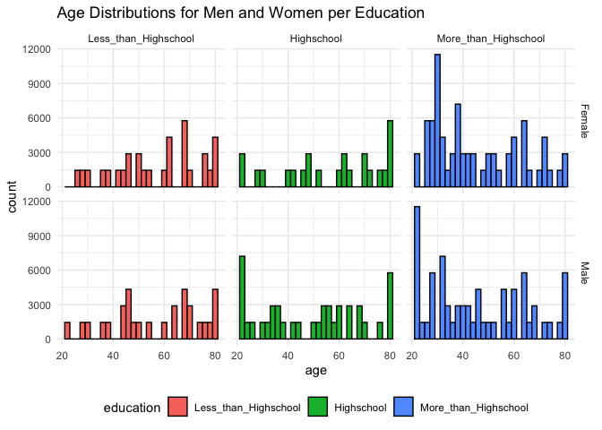

p8105_hw3_ryd2106.Rmd
================
Risa Dickerman
2026-10-14

\#Problem 2

``` r
accel = read_csv("./data_hw3/nhanes_accel.csv",
                  na = c("", ".", "NA"),
                 col_types =cols(
                   SEQN = col_factor()
                 )) |> 
  pivot_longer(
    min1:min1440,
    names_to = "minute",
    values_to = "mims") |> 
  janitor::clean_names()


covar = read_csv("./data_hw3/nhanes_covar.csv", skip = 4,
  na = c("", ".", "NA"), 
  col_types = cols(
    sex = col_factor(),
    education = col_factor(),
    SEQN = col_factor(),
    age = col_integer()
    )) |> 
    filter(
    BMI != is.na(BMI),
    age != is.na(age),
    education != is.na(education),
    sex != is.na(sex)
      ) |> 
  janitor::clean_names()


covar_accel = right_join(accel, covar,  by = "seqn") |> 
  filter(age>=21)
```

``` r
gender = covar_accel |> 
  distinct(seqn, sex, education, age, mims, minute) |> 
  mutate(
    sex = case_match(
      sex,
      "1" ~ "Male",
      "2" ~ "Female"
    )) |> 
  mutate(
    education = case_match(
      education,
      "1" ~ "Less_than_Highschool",
      "2" ~ "Highschool",
      "3" ~ "More_than_Highschool"
    )) |> 
  mutate(
    education = forcats::fct_relevel(education, c("Less_than_Highschool", "Highschool", "More_than_Highschool"))
    ) |>
  arrange(education) 
```

    ## Warning: There was 1 warning in `mutate()`.
    ## ℹ In argument: `sex = case_match(sex, "1" ~ "Male", "2" ~ "Female")`.
    ## Caused by warning:
    ## ! `case_match()` was deprecated in dplyr 1.2.0.
    ## ℹ Please use `recode_values()` instead.

``` r
gender_edu_t = gender|> 
  janitor::tabyl(education, sex) 

gender_age_edu_p = gender |> 
  ggplot(aes(x = age, fill = education)) +
  geom_histogram(binwidth = 2, color = "black") +
  facet_grid(sex~education) +
  labs(
    title = "Age Distributions for Men and Women per Education",
    
  )
theme_set(theme_minimal() + theme(legend.position = "bottom"))

gender_edu_t
```

    ##             education Female  Male
    ##  Less_than_Highschool  40320 38880
    ##            Highschool  33120 50400
    ##  More_than_Highschool  84960 80640

``` r
gender_age_edu_p
```

<!-- -->
To create a table of gender to education level, I first created a gender
data frame. For this data frame, I ensured that that there were not
multiple counts of the same seqn variable. For legibility, I renamed the
numerical factors of sex and education to their corresponding literal
labels. I then ensured that the education level followed a linear
progression from less than a highschool education to more than a
highschool education. This dataframe was piped into the tabyl function
to create a reader friendly table of counts of education level by sex.

To create a histogram of the number of age distributions for men and
women in each education category, I piped in the gender data frame into
the ggplot function. I specified that it must be a histogram, colored by
education level. Faceting by sex and education, I created a side by side
comparison of these distributions. For aesthetics I converted the theme
to be more minimal, widened the bins, and colored the outside of the
bins black.

``` r
act_level_p = gender |> 
   group_by(seqn) |> 
  mutate(
    total_activity = sum(mims)
  ) |> 
  ungroup() |> 
  distinct(seqn, total_activity, age, sex, education) |> 
   ggplot(aes(x = age, y = total_activity, color = sex))+
  geom_point() +
  geom_smooth() +
  facet_grid(~education) +
  labs(
    title = "Total Activity Level by Age. Comparisons by Sex and Education."
  )
  
act_level_p
```

    ## `geom_smooth()` using method = 'loess' and formula = 'y ~ x'

<!-- -->
To create a plot comparing total activity level by age, with a further
comparison by sex and education, I piped in the previously created
gender data frame. From this I aggregated the mims across the minutes of
the day to create a total activity level variable. To ensure that no
seqn values were double counted, I passed the resulting table through
the distinct function. I then created a scatterplot of the total
activity vs age of the participant. This plot was faceted by education
and a comparison of gender was done by coloring by this variable. I
finally added a title.
